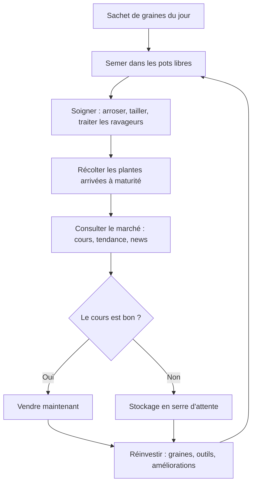

# 🌱 Le Grainier — Architecture de jeu

> **Pitch.** Tu collectionnes, cultives et revends des plantes. Chaque jour, un sachet de graines gratuit. Mais la vraie profondeur du jeu, c'est le **marché** : le cours des plantes fluctue comme une bourse, poussé par la mode, les événements et les ventes des autres joueurs. Cultiver est facile ; vendre **au bon moment**, c'est là que tu gagnes.

---

## 1. Piliers de design

| Pilier                                        | En une phrase                                                        | Ce que ça interdit                          |
| --------------------------------------------- | -------------------------------------------------------------------- | ------------------------------------------- |
| 🧑‍🌾 **Cultivation satisfaisante**           | Voir pousser, fleurir, devenir beau — le plaisir visuel avant tout   | Les timers punitifs et la frustration       |
| 📈 **Marché lisible**                         | Les prix bougent pour des raisons qu'on peut comprendre et anticiper | La volatilité aléatoire et absurde          |
| 🗓️ **Rituel quotidien court**                | 5 minutes par jour suffisent pour progresser                         | Le farming obligatoire de plusieurs heures  |
| 📚 **Collection qui raconte**                 | Chaque plante est une découverte (encyclopédie, raretés, anecdotes)  | Les doublons sans valeur ni usage           |
| 🤝 **Monde habité, pas concurrentiel brutal** | Les autres joueurs font vivre le marché, pas la guerre               | Le PvP direct et les classements aggressifs |
| 🎓 **Apprendre en jouant**                    | Le jeu t'apprend de vraies choses sur les plantes                    | La leçon qui sent le manuel scolaire        |

---

## 2. La boucle de gameplay

### 2.1 Boucle courte — la session (5 à 15 min)

### 2.2 Boucle moyenne — la journée

- **Le sachet du jour** : gratuit, ouvrable quand tu veux (pas de punition si tu ne viens pas, mais pas de cumul non plus — ou cumul limité à 3 jours pour les joueurs occasionnels).
- **Pousses pendant ton absence** : les plantes continuent de croître et de générer un petit revenu passif (boute en ligne, mais modeste, pour que la session active reste utile).
- **Événement de marché quotidien** : une news botanique déplace les cours (« un magazine déco met les monstera à la mode »).

### 2.3 Boucle longue — la semaine et au-delà

- **Prestige botanique** : quand ta collection et ta fortune dépassent un palier, tu peux « léguer ta serre » — tu repars avec une serre plus modeste mais des bonus permanents et un taux de rareté amélioré sur les sachets.
- **Saisons** : certaines plantes ne se cultivent bien qu'à certaines saisons ; le marché suit (les poinsettias flambent en décembre, personne n'en veut en mars).
- **Quêtes de collection** : l'almanach propose des objectifs (« cultive 5 orchidées différentes », « vends une plante au-dessus de X ») qui récompensent en graines rares.

---

## 3. Features

### 3.1 Le sachet de graines quotidien 🎁

- **Un sachet gratuit par jour**, à ouvrir avec un petit suspense (animation de débouchage).
- **Raretés pondérées** : commun (grande majorité), rare, exotique, légendaire. Les probabilités s'améliorent avec la progression et le prestige.
- **Poids thématique** : le contenu du sachet « penche » vers ce dont le marché a besoin, pour lier le rituel à l'économie.
- **Sachets achetables en boutique** (avec l'argent du jeu) pour les impatients — ciblés (« sachet orchidées », « sachet rustiques ») ou mystère.
- **Échange des doublons** : un doublon n'est jamais un déchet — transformable en engrais, en tickets d'échange, ou en objet de don.

### 3.2 La culture et l'environnement 🪴

**La croissance**

- **Étapes visibles** : graine → pousse → végétatif → boutons → floraison. Chaque étape rapporte plus à la vente.
- **La qualité du spécimen compte** : une plante parfaitement soignée et bien placée se vend nettement plus cher — c'est ce qui récompense le soin actif.
- **Spécimens d'exposition** : les plus belles plantes peuvent être exposées plutôt que vendues — elles attirent des visiteurs (et des clients) dans la serre.

**L'environnement change tout : lumière, température, humidité**

- Chaque espèce a **trois tolérances**, exactement comme dans la vraie vie :
  - *Lumière* : de l'ombre profonde au plein soleil ;
  - *Température* : une plage de confort (une orchidée et un cactus n'ont pas les mêmes goûts) ;
  - *Humidité de l'air* : de l'air sec de la véranda au coin tropical à 80 %.
- La serre est découpée en **micro-zones climatiques** : la table plein sud baignée de lumière, l'ombre sous l'étagère du fond, l'air humide près du bassin de brumisation, le courant d'air plus frais près de la porte. Une même serre offre des dizaines d'environnements différents.
- **Le placement est une vraie décision** : la bonne plante à la bonne place pousse plus vite et atteint une meilleure qualité. Au mauvais endroit, elle ralentit, s'abîme et devient la cible des maladies et ravageurs.
- **Signaux visuels honnêtes** : le jeu montre toujours *pourquoi* ça va mal — feuilles qui frisent au soleil, terre qui sèche en croûte près du radiateur, moisissure là où l'air stagne. Le joueur diagnostique comme un vrai jardinier, sans jargon.
- **Connaître ses plantes est un avantage de jeu** : la fiche botanique n'est pas décorative, c'est le mode d'emploi. Après quelques semaines, le joueur *sait* qu'une fougère veut l'ombre et l'humidité — et c'est vrai dans la vraie vie aussi.
- **Climat de saison** : la température des micro-zones suit les saisons. En hiver, la serre non chauffée devient froide : les tropicales doivent être rentrées en serre chaude, les rustiques restent dehors. La réorganisation saisonnière de la serre devient un rituel de jeu.

### 3.3 La serre : un espace à construire 🏛️

L'agencement devient une couche de jeu à part entière : la serre n'est pas un menu, c'est un **lieu** que l'on aménage.

- **La hauteur sous plafond compte** : un palmier ou un avocatier adulte a besoin de 2 mètres de hauteur libre — impossible sur une étagère, il lui faut une place au sol. Les très grandes plantes sont encombrantes mais se vendent très cher : arbitrage permanent entre dix petites plantes et une seule imposante.
- **Étagères et niveaux** : multiplier les emplacements verticalement... mais l'étagère du haut capte toute la lumière, celle du bas vit à l'ombre. Plus de place = plus de diversité climatique = plus d'espèces cultivables simultanément.
- **Zones spécialisées à débloquer** :
  - *Serre chaude* : chauffée, pour les tropicales (orchidées, bananier, anthurium) — coûteuse en entretien ;
  - *Serre froide / tunnel* : protège les rustiques en hiver, économique ;
  - *Coin ombragé* : ombrière installée pour fougères, mousses et calathées ;
  - *Véranda plein sud* : canon à lumière pour cactus et succulentes.
- **Équipements structurels qui redessinent la carte climatique** : brumisateur, chauffage, ventilation, ombrière, lampe horticole. Chaque achat transforme des micro-zones — le joueur réorganise toute sa collection au fil de ses acquisitions. C'est une deuxième couche de progression, *l'espace* en plus de l'argent.
- **Logistique douce** : table de rempotage, réserve de pots, bac à doublons, établi de semis. La serre raconte le style du joueur — collectionneur, marchand ou paysagiste.
- **Trophée et vitrine** : l'agencement est visible par les visiteurs (clients, puis autres joueurs en multijoueur) — une belle serre vend mieux.

### 3.4 Les ravageurs et les soins 🐛

- **Pucerons, cochenilles, oïdium, araignées rouges** — chaque ravageur a son apparence et sa plante préférée.
- **Phase 1 — à la main** : au début, on retire les pucerons un par un (petite interaction tactile, presque un antistress).
- **Phase 2 — l'automatisation** : on achète la solution à ce qui nous ennuie — coccinelles lâchées dans la serre, plante-piège, diffuseur anti-ravageurs. C'est le cœur du plaisir idle : *mon argent me libère des corvées*.
- **Le choix stratégique** : traiter coûte (produit, temps) ; une plante infestée perd de la valeur chaque heure. Parfois il vaut mieux sacrifier un plant commun pour sauver une rare.
- **Ravageurs rares « utiles »** : certains insectes rares peuvent être capturés et ajoutés à l'encyclopédie (clin d'œil à Plant Tycoon).

### 3.5 Le marché 📊

La feature signature du jeu.

- **Un cours par famille de plantes** (orchidées, succulentes, aromatiques, fougères, fleurs à bouquet…), visible avec courbe de tendance, flèches et news.
- **Quatre forces qui déplacent les prix** :
  1. **La mode** (événements narratifs) : « les plantes d'intérieur font le buzz sur les réseaux » → hausse temporaire.
  2. **Les saisons et fêtes** : prévisibles, elles récompensent l'anticipation.
  3. **L'offre des joueurs** : si tout le monde vend ses monstera, le cours du monstera baisse.
  4. **Le retour à l'équilibre** : un cours qui a trop baissé finit par remonter lentement (les prix restent dans une fourchette raisonnable).
- **News lisibles** : chaque mouvement a sa cause affichée (« Un grand hôtelier refleurit ses halls — les plantes dépolluantes sont recherchées »). Le joueur apprend à lire le marché, pas à subir.
- **Contrats de fournisseur** : un fleuriste ou un hôtel te propose de livrer X plantes d'une famille donnée à une date donnée, à un prix garanti. Accepter = securité ; refuser = spéculer au cours du moment.
- **Alertes personnalisables** : préviens-moi quand le cours des orchidées dépasse tant.

### 3.6 La vente et le réinvestissement 💰

- **Vendre = choisir le moment** : vente immédiate au cours du jour, ou stockage en serre d'attente (le stockage a une capacité limitée — une vraie ressource).
- **Réinvestissement** :
  - *Graines* : boutique ciblée ou échanges de doublons.
  - *Équipement* : arrosoirs automatiques, lampe de serre, gants anti-pucerons, plus grands pots.
  - **Espace** : nouveaux pots, nouvelles étagères, deuxième serre.
  - **Automatisation** : c'est la principale dépense de fin de jeu — rendre la serre autonome.
- **Spéculation douce** : pouvoir acheter des plants (pas seulement des graines) à bas prix quand un cours s'effondre, les soigner, et les revendre à la remontée. Un mini-game de « flip » botanique.

### 3.7 La fiche plante et l'aspect éducatif 🎓📖

**La fiche de chaque plante**

Chaque espèce de la collection a sa fiche complète dans l'almanach :

- *Illustration* façon planche d'herbier ;
- *Identité* : nom commun, nom scientifique, famille botanique, aire d'origine ;
- *Fiche de culture* : ses tolérances lumière / température / humidité, ses ravageurs habituels, sa saison — **ces informations sont réelles** et directement utilisables dans le jeu ;
- *Anecdote* : une ou deux lignes étonnantes (le monstéra perce ses feuilles pour laisser passer la pluie de la canopée ; le tilleul des rues n'est pas un tilleul sauvage…) ;
- *Dans le jeu* : valeur, fourchette de cours, vitesse de croissance, encombrement ;
- *Chez toi* : un conseil de culture vrai, transposable chez le joueur (« cette plante supporte d'être rempotée au printemps, jamais en hiver »).

**Une pédagogie par l'usage, jamais par la leçon**

- On retient les besoins d'une plante parce que la mal placer coûte cher, pas parce qu'un texte l'impose. Le savoir est *la récompense* du jeu.
- Les fiches se débloquent progressivement : d'abord les infos vitales (lumière, eau), puis les anecdotes au fil des floraisons — la fiche se « mérite ».
- **Quiz de l'almanach (optionnel)** : petites questions bonus contre des tickets d'échange de graines, pour les joueurs qui veulent creuser.
- **Effet long terme** : après quelques semaines, le joueur sait vraiment arroser une orchidée, repérer un manque de lumière, lire une plante. Argument marketing en soi : *« le jeu qui t'apprend vraiment le jardinage »*.

**La collection au-delà des fiches**

- **Raretés et variantes** : mêmes espèces en variantes (panachées, dorées…) beaucoup plus rares — la chasse aux variantes motive le sachet quotidien sur le long terme.
- **Trophées de serre** : plantes exposées, insectes capturés, badges de quêtes.
- **Croisements (v2)** : hybrider deux plantes pour tenter des espèces uniques — la couche « laboratoire » qui prolonge la durée de vie.

---

## 4. Progression — les 3 profils de joueur

| Profil                   | Ce qu'il fait                                | Ce que le jeu doit lui offrir                                                      |
| ------------------------ | -------------------------------------------- | ---------------------------------------------------------------------------------- |
| 🧘 **Le zen**            | Arrose, regarde pousser, vend tranquillement | Aucune pression ; le marché reste optionnel (vente au « prix conseillé » possible) |
| 📈 **Le spéculateur**    | Lit les news, stocke, vend au pic            | De la profondeur de marché, des contrats, des statistiques                         |
| 🏆 **Le collectionneur** | Veut 100 % de l'encyclopédie                 | Sachets pondérés, échanges, croisements, quêtes d'almanach                         |

Le jeu ne doit jamais forcer un profil : le marché avance tout seul (cours par défaut correct), la collection avance toute seule (sachets quotidiens), et la spéculation est un bonus.

---

## 5. Multijoueur — montée en puissance progressive

Le multijoueur est **asynchrone et coopératif**, jamais du temps réel concurrentiel (incompatible avec un idle).

### Niveau 0 — Solo avec marché simulé (au lancement)

- Le marché vit tout seul : mode, saisons, événements scriptés + une part de fluctuation « vivante ».
- Zéro contrainte serveur, équilibrage maîtrisé. C'est la version qui doit être excellente.

### Niveau 1 — Le marché mondial partagé 🌍

- Les ventes de **tous** les joueurs influencent les cours (chaque vente fait très légèrement baisser le cours de sa famille ; l'absence de vente le fait remonter).
- Garde-fous : fourchettes de prix minimales/maximales, lissage des ventes massives, régions de marché séparées si un segment sature.
- Effet recherché : la sensation d'un monde vivant — « ce week-end tout le monde a vendu ses succulentes, le cours s'est écroulé ».

### Niveau 2 — Le social asynchrone 🤝

- **Visites de serres** : voir la collection et l'agencement des autres, laisser un « pouce vert ».
- **Dons et échanges de graines** : spécialisation douce (« j'ai plein d'orchidées, toi des succulentes, échangeons »).
- **Classements doux** : plus belle serre de la semaine, spécimen le plus remarquable — jamais « joueur le plus riche » (toxique).

### Niveau 3 — Clubs botaniques 🏛️

- Petites guildes (5 à 20 membres) avec objectifs collectifs hebdomadaires (« livrez ensemble 50 aromatiques au marché »).
- Récompenses : graines de club exclusives, décors de serre, badges.
- **Expositions florales saisonnières** : concours de spécimens entre clubs, jurés par votes des joueurs.

**Recommandation** : lancer en Niveau 0, ajouter le Niveau 1 dès que la base de joueurs le justifie (c'est l'argument massue du jeu), puis monter progressivement. Chaque niveau doit être un événement de mise à jour, pas un jour 1.

---

## 6. Ce qui rend le jeu différent

1. **Marché dynamique + botanique** : aucune combinaison existante de ces deux-là dans le genre idle.
2. **Le soin actif qui devient automatisation** : on ne subit pas les pucerons, on s'enrichit pour s'en libérer.
3. **Le sachet quotidien lié à l'économie** : pas qu'un ritual gratuit, un vrai rouage.
4. **Un idle sans punition** : pas de plantes mortes après un week-end d'absence (référence aux frustrations de Plant Tycoon) — au pire, elles marquent une pause et réclament un soin à ton retour.
5. **Une serre-lieu, pas un menu** : lumière, température et humidité font de l'aménagement (hauteur sous plafond, étagères, zones spécialisées) une couche de jeu à part entière.
6. **Éducatif sincère** : des fiches botaniquement justes qui *servent* le gameplay — le joueur apprend de vraies choses sans jamais se sentir à l'école.

---

## 7. Décisions ouvertes

- [ ] **Univers** : botanique réaliste (espèces réelles, fiches pédagogiques vraies) vs fantaisiste vs mélange. → *Recommandation : réaliste — c'est la condition de l'aspect éducatif ; variantes fantaisistes très rares en récompense d'end-game.*
- [ ] **Support de départ** : mobile-first, web-first, ou les deux dès le départ.
- [ ] **Direction artistique** : aquarelle/botanique d'herbier, pixel art cozy, ou 3D mignonne — à tester par mockups.
- [ ] **Nom du jeu** : « Le Grainier » est un titre de travail.

## 8. Prochaines étapes suggérées

1. **Paper-playtest de la boucle courte** : simuler une semaine de jeu sur papier pour vérifier le rythme (combien de décisions intéressantes par jour ?).
2. **Définir les 20 premières espèces** avec leurs vraies données botaniques (tolérances, origine, anecdotes) — elles servent de gabarit à toutes les fiches suivantes.
3. **Carte climatique de la première serre** : dessiner les micro-zones de la serre de départ et vérifier qu'elle offre déjà des environnements contrastés (lumineux / ombragé, sec / humide).
4. **Équilibrage du marché** : définir les fourchettes de prix par famille, la vitesse de fluctuation, la force de chaque événement de mode.
5. **Maquette du sachet quotidien, de la serre et de la fiche plante** : les trois écrans qui portent l'expérience.
6. **Prototype jouable** de la boucle courte (sans marché partagé), test sur une semaine réelle de rituel quotidien.

---

## 9. Données botaniques ouvertes 📚

Le contenu éducatif n'a pas à être écrit de zéro : plusieurs sources ouvertes existent, **avec photos**.

### Nomenclature et fiches

- **Trefle** (trefle.io) : API botanique ouverte, \~450 000 plantes, agrège USDA, Kew, IPNI, Tropicos, Tela Botanica et Wikimedia. Idéal pour noms, familles, distributions. Limite : les conditions de culture y sont très peu renseignées.
- **Plants of the World Online (Kew)** : la référence — 1,2 million de noms, \~109 000 descriptions détaillées, \~314 000 images. Téléchargeable pour la recherche.
- **Tropicos** (Missouri Botanical Garden) et **World Flora Online** : nomenclature et spécimens d'herbier.
- **Wikipédia / Wikidata** : descriptions, anecdotes et classification réutilisables (licence CC BY-SA, attribution requise).

### Photos

- **Pl@ntNet via GBIF** : \~14 millions de photos de plantes géolocalisées, publiées en CC BY 4.0 — réutilisables commercialement avec crédit.
- **iNaturalist** : photos de qualité variable par image ; licence choisie photo par photo (beaucoup en CC, mais le défaut est CC BY-NC, **non commercial** — vérifier chaque image).
- **Wikimedia Commons** : immense catalogue, licence par image (CC0, CC BY, CC BY-SA) + trésor méconnu : les **planches botaniques anciennes dans le domaine public** (Curtis's Botanical Magazine, Köhler…), parfaites pour l'esthétique « herbier » du jeu.
- **Kew Data Portal** : images haute résolution des spécimens d'herbier numérisés (plus de 4 millions de notices).

### ⚠️ Règles pour le jeu

1. **Vérifier la licence de chaque image** : CC BY et CC BY-SA = utilisables (avec crédit), CC BY-NC = interdit dans un jeu commercial, domaine public = libre.
2. **Ne pas importer en masse** : le jeu n'a besoin au départ que de 20 à 50 espèces bien documentées. Une curation manuelle (fiches croisées Trefle + Kew + Wikipédia) sera plus fiable qu'un import automatique.
3. **Les stats de gameplay ne sont nulle part** : tolérances lumière/température/humidité à des fins de jeu relèvent de l'horticulture, pas de la botanique académique — à rédiger à la main à partir de sources jardin (RHS, guides de culture), en gardant le jeu lisible plutôt que réaliste au degré près.

---

## 10. Modèle économique 💵

### Le modèle retenu : **sans publicité**

Le standard du genre idle/casual est l'hybride (pubs récompensées + achats + pass), mais **Le Grainier n'intègre aucune publicité** — ni forcée, ni récompensée. Conséquence assumée : le modèle repose entièrement sur l'achat et l'abonnement, et chaque produit doit être assez désirable pour compenser. C'est aussi un argument marketing fort pour un jeu « zen » : *aucune pub, jamais*.

### Ce que Le Grainier peut vendre

| Produit                              | Exemple concret                                                                                                 | Pourquoi ça marche                                                           |
| ------------------------------------ | --------------------------------------------------------------------------------------------------------------- | ---------------------------------------------------------------------------- |
| 🎨 **Cosmétiques de serre**          | Pots décorés, serres à thème (japonaise, victorienne, designer), corniches, cachepots, styles de fiches herbier | L'expression sans pouvoir — la serre est la vitrine du joueur                |
| 🗓️ **Pass saisonnier « Almanach »** | Piste gratuite + piste premium : graines de saison, décors, variants de fiches                                  | Cadence avec les saisons du jeu ; convertible et respectueux du temps de jeu |
| ⭐ **Abonnement de confort**          | Emplacements de stockage en plus, statistiques de marché avancées, seconde serre d'ornement                     | Revenu récurrent des joueurs fidèles                                         |

### Ce que le jeu ne doit JAMAIS vendre

- ❌ **Argent du jeu, plantes ou graines contre argent réel** : pay-to-win, et surtout cela **casserait le marché partagé** (le cœur du jeu est de gagner par ses décisions, pas par son portefeuille).
- ❌ **Le sachet quotidien** : c'est le rituel fondateur, il reste gratuit pour tous.
- ❌ **Des statistiques de marché exclusives aux payants** : le marché doit être équitable pour rester intéressant.

### Deux trajectoires possibles selon le support

- **Steam / version premium** : jeu payant (10-20 €) sans pub ni achats intrusifs, contenu complet. Le plus aligné avec le positionnement sans pub — communauté fidèle, pas de charge de live-ops publicitaire.
- **Mobile gratuit (sans pub)** : cosmétiques de serre + pass Almanach + abonnement de confort uniquement. Revenus plus faibles par joueur qu'un hybride à pub, mais une image de marque cohérente avec un jeu zen et éducatif.

→ *Recommandation pour un premier jeu solo : **version premium (Steam/web)** pour valider la boucle en toute liberté, puis le mobile gratuit-sans-pub si l'audience suit.*

**Compensation de l'absence de pub** — les joueurs non-payants doivent malgré tout financer le jeu indirectement :

- La boucle quotidienne gratuite doit rester pleinement satisfaisante (un joueur non-payant heureux recommande le jeu).
- Le pass Almanach à prix accessible (5-10 €) devient le produit d'appel principal.
- Le contenu éducatif et esthétique (belles fiches, planches d'herbier) est la preuve de valeur qui justifie l'achat — exactement comme un beau livre de botanique se vend sans pub.
